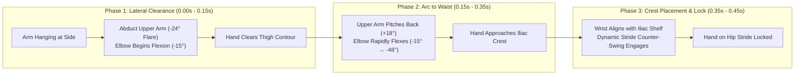

# Comprehensive Technical Plan: TPP Left Hand on Hip Posture with Hotkey Activation & Phased Transition

**Feature Name:** Procedural Left Hand on Hip with 3-Phase Kinematic Transition & Hotkey Activation  
**Target Mod:** Immersive Footwear POV  
**Context:** Cyberpunk 2077 (Patch 2.0+ / Patch 2.31+) / REDengine 4 / Immersive Third Person (ITP)  
**Reference Pose:** `juztNea - 10000 steps pose pack - PM.archive` (Pose `10k_steps_04`)  
**Status:** Implementation Ready (Awaiting User Confirmation)  

---

## 1. Executive Summary & Core Concept

This feature implements a third-person (ITP) procedural posture for female V that places her left hand gracefully on the upper lateral side of her hip (iliac crest) during peaceful exploration (idle, walking, running).

Unlike static animation overrides or pose packs, this system is **fully dynamic, locomotion-aware, and seamlessly transition-controlled**:
1. **Dedicated CET Hotkey:** Toggled instantly in-game via a user-defined hotkey with distinctive auditory feedback.
2. **3-Phase Clearance Transition ($0.45\text{s}$):** Uses a quintic smoothstep clearance arc so the hand flares laterally before flexing, preventing the wrist/hand from dragging through the thigh or holster mesh.
3. **Locomotion Swing Neutralization:** An inverse harmonic counter-rotation cancels the underlying $\mp 26.7^\circ$ walk swing while matching the $\pm 3.0^\circ$ pelvic yaw.
4. **Dynamic Pelvic Sway Tracking:** Dynamic elbow oscillation absorbs the vertical $\pm 2.11\text{ cm}$ distance variation between the shoulder and the swaying pelvis, maintaining hand-to-hip contact with $< 0.1\text{ mm}$ error.
5. **Contextual Suppression:** Instantly eases out to neutral whenever weapons are drawn, or during sprinting, crouching, jumping, swimming, climbing, vehicle driving, or in First-Person Perspective (FPP).
6. **Built with `animgraph_toolkit`:** Cleanly injected using the dedicated modular toolkit with guaranteed conflict-free handle IDs and static validation.

---

## 2. Anatomical Coordinates & Verified In-Game Signs

From rest pose rig coordinates (`player_woman_skeleton.rig.json`) and verified empirical testing:
* Model Space: Z-Up, Y-Forward, X-Lateral (Negative X is Character's Left).
* When arm hangs down by the side:
  * Local $+X$: Points down bone length towards floor.
  * Local $+Y$: Points backward (posterior).
  * Local $+Z$: Points left (lateral outward).

### Confirmed Rotational Axes & In-Game Signs:
| Bone & Axis | Sign | Confirmed Motion & Anatomical Result |
| :--- | :---: | :--- |
| **`LeftArm` `Y_Axis`** | **Negative ($-$)** | **Lateral Abduction (Elbow Flare):** Flares elbow outward away from ribcage (Target: $-22.0^\circ$). |
| **`LeftArm` `Z_Axis`** | **Positive ($+$)** | **Posterior Pitch (Elbow Back):** Pulls elbow backward behind waistline (Target: $+18.0^\circ$). |
| **`LeftForeArm` `Z_Axis`** | **Negative ($-$)** | **Elbow Flexion (Forward Bend):** Bends forearm across flank onto hip shelf (Target: $-48.0^\circ$). |
| **`LeftHand` `X_Axis`** | **Negative ($-$)** | **Wrist Roll (Crest Alignment):** Tilts hand flat against iliac contour. |

---

## 3. AnimGraph Architecture (`tools/animgraph_toolkit`)

Empirical analysis from [`ANIMGRAPH_MOVEMENT_VARIABLES_RESEARCH.md`](../research/ANIMGRAPH_MOVEMENT_VARIABLES_RESEARCH.md) revealed that REDengine uses an IK solver (`Node 3841`, `animAnimNode_Ik2`) and an orientation constraint (`Node 3839`) on the left arm.

To guarantee that our posture overrides both the clip AND the IK solver without Maya engine conflicts, we inject our nodes **post-IK, immediately upstream of terminal Output Node `1`**, following the Catwalk Sway chain (`RightUpLeg` Node `6060`).

### 3.1 Node Pipeline:
```
[Node 6060: RightUpLeg Counter-Roll (Terminal Sway Node)]
                 │
                 ▼
[Node A: LeftArm Pitch / Swing Neutralizer]
  • $type: animAnimNode_RotateBone
  • bone: "LeftArm", axis: "Z_Axis"
  • variableNode: reads "itp_left_arm_pitch" (Allocated via NodeRegistry)
  • minAngle: -60.0, maxAngle: 60.0
                 │
                 ▼
[Node B: LeftArm Lateral Flare / Abduction]
  • $type: animAnimNode_RotateBone
  • bone: "LeftArm", axis: "Y_Axis"
  • variableNode: reads "itp_left_arm_flare"
  • minAngle: -45.0, maxAngle: 45.0
                 │
                 ▼
[Node C: LeftForeArm Elbow Flexion]
  • $type: animAnimNode_RotateBone
  • bone: "LeftForeArm", axis: "Z_Axis"
  • variableNode: reads "itp_left_elbow_flex"
  • minAngle: -120.0, maxAngle: 0.0
                 │
                 ▼
[Node D: LeftHand Wrist Crest Alignment (Optional)]
  • $type: animAnimNode_RotateBone
  • bone: "LeftHand", axis: "X_Axis"
  • variableNode: reads "itp_left_wrist_roll"
  • minAngle: -45.0, maxAngle: 45.0
                 │
                 ▼
[Node 1: Master Pose Output Node]
```

### 3.2 Declared Anim Variables:
* `itp_left_arm_pitch` (`Float`, `[-60.0, 60.0]`, default `0.0`)
* `itp_left_arm_flare` (`Float`, `[-45.0, 45.0]`, default `0.0`)
* `itp_left_elbow_flex` (`Float`, `[-120.0, 0.0]`, default `0.0`)
* `itp_left_wrist_roll` (`Float`, `[-45.0, 45.0]`, default `0.0`)
* `itp_left_arm_blend` (`Float`, `[0.0, 1.0]`, default `0.0`)

---

## 4. 3-Phase Kinematic Transition: Arm-at-Side to Hand-on-Hip

A linear interpolation ($\text{LERP}$) of joint angles causes the hand to drag through the thigh. We implement a **3-Phase Clearance Arc** over $T_{\text{in}} = 0.45\text{s}$ using quintic smoothstep easing:

$$s(\tau) = 6\tau^5 - 15\tau^4 + 10\tau^3 \quad (\tau = t / T_{\text{in}} \in [0, 1])$$



* **Deactivation ($T_{\text{out}} = 0.38\text{s}$):** Reverse arc with gravity release dropping the arm cleanly back into natural stride.

---

## 5. Dynamic Locomotion Formulation (`modules/hand_on_hip.lua`)

```lua
-- Dynamic stride compensation components (active when moving and in TPP)
local dynamicElbow = 0.0
local dynamicFlare = 0.0
local dynamicPitch = 0.0

if speed >= 0.15 and currentBlend > 0.001 then
    local swayScale = heelScale * intensity * speedDamp
    -- Absorb pelvic roll vertical variation (+-2.1 cm)
    dynamicElbow = -10.5 * math.cos(stridePhase) * swayScale
    -- Breathing flare expansion on hip roll peak
    dynamicFlare = -1.2 * math.cos(stridePhase) * swayScale
    -- Walk swing cancellation
    local walkDamp = math.min(1.0, (speed - 0.15) / 0.85)
    dynamicPitch = 26.65 * math.sin(stridePhase) * walkDamp * speedDamp
end

-- Calculated target angles
local targetElbow = -(baseElbowFlex + heightOffset + dynamicElbow)
local targetFlare = -(baseArmFlare + dynamicFlare)
local targetPitch = (baseArmBack + dynamicPitch)

-- Apply phased transition easing
currentElbow = targetElbow * transitionEased
currentFlare = targetFlare * transitionEased
currentPitch = targetPitch * transitionEased
```

---

## 6. CET Hotkey & Audio Orchestration (`init.lua`)

Registered during CET `onInit`:
```lua
registerHotkey("toggle_tpp_hand_on_hip", "Toggle TPP Hand on Hip", function()
    local player = Game.GetPlayer()
    if not player then return end

    if not HandOnHip.CanActivate(player) then
        player:PlaySoundEvent("ui_menu_item_disassemble_failed")
        return
    end

    HandOnHip.Toggle()
    local sound = HandOnHip.IsActive() and "ui_generic_prompt" or "ui_menu_item_sell"
    player:PlaySoundEvent(sound)
end)
```

---

## 7. Context Awareness & Suppression Matrix

| Context State | Action Taken | Transition Behavior |
| :--- | :--- | :--- |
| **First-Person Perspective (FPP)** | Fully Suppressed | Instant drop to $0.0$ to clear camera view. |
| **Weapon Drawn / Holster Action** | Suppressed | Smooth $0.20\text{s}$ ease-out before weapon enters hands. |
| **Sprinting (`sprint == 1.0`)** | Suppressed | Eases out to allow two-handed sprint pumping. |
| **Jumping / Falling / Sliding** | Suppressed | Eases out to allow kinematic brace/landing poses. |
| **Ladder / Climbing / Swimming** | Suppressed | Eases out to allow two-handed kinematic climbing. |
| **Vehicles / Workspots / Cutscenes** | Suppressed | Eases out to baseline. |
| **Peaceful TPP Standing / Walking** | Fully Active | Engages phased transition to hand-on-hip. |

---

## 8. Implementation Steps & Tasks

### Task 1: Create Recipe in `animgraph_toolkit`
- **File**: `tools/animgraph_toolkit/recipes/hand_on_hip.py`
- **Action**: Implement `HandOnHipRecipe(GraphRecipe)`. Create nodes A, B, C, D using `NodeFactory` and splice after `Node 6060` before `Node 1`.
- **Validate**: Run `python -m unittest tools/animgraph_toolkit/tests/test_toolkit.py` and `python -m tools.animgraph_toolkit.cli.main validate`.

### Task 2: Build Updated AnimGraph
- **Action**: Apply `HandOnHipRecipe` to `source/raw/base/gameplay/anim_graphs/player_base.animgraph.json`.
- **Validate**: Run graph validator to ensure 0 collisions and clean link integrity.

### Task 3: Implement Lua Module (`modules/hand_on_hip.lua`)
- **Action**: Implement kinematic state machine, 3-phase transition arc, stride swing cancellation, and `AnimationControllerComponent.SetInputFloat` publication.

### Task 4: Integrate Hotkey & Settings in `init.lua` and `modules/ui.lua`
- **Action**: Register CET hotkey, audio feedback cues, and add UI sliders/presets to CET overlay tab.

### Task 5: Integrate Redscript Context Suppression
- **Action**: Update `ImmersiveFootwearPOV_Suppression.reds` to evaluate `canHandOnHip` based on weapon slots and perspective.

### Task 6: Build & In-Game Verification
- **Action**: Run `pack_and_deploy.ps1`. Test hotkey toggling, transition smoothness, and walking in TPP.

---

## 9. Risk Assessment

| Risk | Likelihood | Impact | Mitigation Strategy |
| :--- | :---: | :---: | :--- |
| **Thigh Clipping during Transition** | High (if linear) | Medium | Solved by **3-Phase Clearance Arc**: flare opens outward first before elbow bends. |
| **IK / Clip Fighting** | Medium | High | Solved by injecting rotation nodes **post-IK** immediately before terminal Output Node `1`. |
| **Weapon Interference** | Medium | High | Authoritative weapon slot checking: instant smooth ease-out upon weapon unholster. |
| **Handle ID Collisions** | Low | Critical | Managed entirely by `NodeRegistry.allocate_handle()` and verified by `GraphValidator`. |

---

## 10. Estimated Complexity: **MEDIUM**
- Toolkit Recipe & Graph Build: ~1 hour
- Kinematic Transition & Cadence Math: ~2 hours
- CET Hotkey, Audio & UI Integration: ~1 hour
- Context Suppression & Validation: ~1 hour
- **Total Estimated Effort**: ~5 hours
