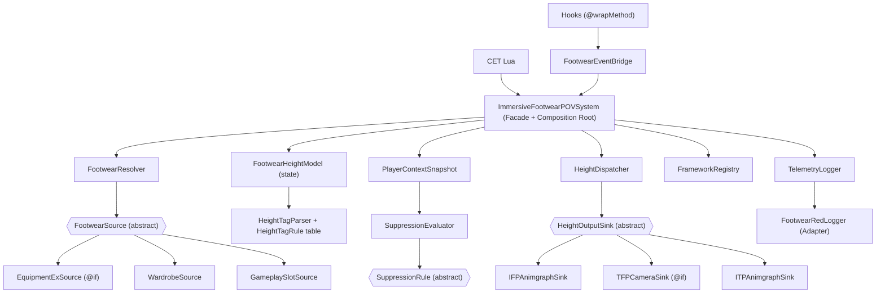

# Plan: Redscript SOLID Refactor — Immersive Footwear POV

**Scope**: `source/resources/r6/scripts/ImmersiveFootwearPOV/**` (11 files, ~1,400 lines)
**Out of scope**: Lua/CET code (left untouched; its API contract is preserved)
**Complexity**: Medium-Large · **Type**: behavior-preserving refactor (except where flagged)

---

## 1. Requirements Restatement

- Restructure the Redscript layer to follow SOLID + the design patterns in `solid_architecture.md`.
- **Zero behavior change** for players, unless you approve a fix listed in §7.
- **Do not break the CET → Redscript contract**: the `ImmersiveFootwearPOV.ImmersiveFootwearPOVSystem` class name and every method Lua calls must stay the same.
- Follow the global CP77 rules: keep `@wrapMethod` hooks non-destructive, keep `@if(ModuleExists)` guards, edit only under `source/`, and keep the uninstaller in sync.

## 2. Active Rules Applied

| Rule | How this plan applies it |
|---|---|
| `solid_architecture.md` | Design the architecture before code (this doc). SRP/OCP/DIP drive each phase. |
| `cp77_mod_architecture.md` | Every hook stays `@wrapMethod`. Optional mods stay behind `@if(ModuleExists)` adapters. |
| `cp77_file_boundaries.md` | Code edits only under `source/`. `packed/` is never touched. |
| `cp77_uninstall_sync.md` | If files get renamed or moved, update `uninstall_ImmersiveFootwearPOV.bat` (see Q2). |
| `cp77_check_examples_first.md` | Checked `examples/True_First_Person`. Nothing in TFP calls back into IFP, so `TFPHelper` is internal. |
| `cp77_investigation_mode.md` | Read-only so far. No files changed. |
| `read_project_md_on_startup.md` | Read PROJECT.md. Note: §4 still points at a missing `HeightController.reds`; that class actually lives in `ImmersiveFootwearPOV_IFP.reds`. |

## 3. Current-State Diagnosis

| # | Smell | Location | Principle broken |
|---|---|---|---|
| 1 | **God object**: about 25 fields covering state, suppression, TFP weapon cache, TFP telemetry cache, framework flags, display names, CET logging and parser passthroughs | [System.reds](file:///c:/Users/cogli/Documents/CyberPunk%20-%20Projects/Immersive%20Footwear%20POV/source/resources/r6/scripts/ImmersiveFootwearPOV/Systems/ImmersiveFootwearPOV_System.reds) | SRP |
| 2 | **Hard-coded output fan-out**: `RecalculateEffectiveOffset` names `HeightController`, `TFPHelper` and `ITPController` directly. Each new POV mod means editing the core. | System.reds L107-127 | OCP, DIP |
| 3 | **Evaluator mutates its caller**: `SuppressionEvaluator.Evaluate` calls `sys.SetSuppressionState(...)` as a side effect of a query | [Suppression.reds](file:///c:/Users/cogli/Documents/CyberPunk%20-%20Projects/Immersive%20Footwear%20POV/source/resources/r6/scripts/ImmersiveFootwearPOV/Systems/ImmersiveFootwearPOV_Suppression.reds) L11-65 | SRP / CQS |
| 4 | Suppression and sway are long `if` chains with magic numbers (`8..13`, `29/31`, `6`), and both read the PSM blackboard separately | Suppression.reds | OCP |
| 5 | Parser prefixes are an `if/else` ladder, repeated twice (heel and platform) | [TweakReader.reds](file:///c:/Users/cogli/Documents/CyberPunk%20-%20Projects/Immersive%20Footwear%20POV/source/resources/r6/scripts/ImmersiveFootwearPOV/ImmersiveFootwearPOV_TweakReader.reds) L135-186 | OCP, DRY |
| 6 | Footwear priority is hard-coded in a single method | [FootwearResolver.reds](file:///c:/Users/cogli/Documents/CyberPunk%20-%20Projects/Immersive%20Footwear%20POV/source/resources/r6/scripts/ImmersiveFootwearPOV/ImmersiveFootwearPOV_FootwearResolver.reds) | OCP |
| 7 | TFP-only state (6 fields, 9 accessors) lives in the core system | System.reds L29-35, L251-271 | SRP, ISP |
| 8 | Telemetry takes the whole system as a parameter (`sys: ref<ImmersiveFootwearPOVSystem>`) | [Telemetry.reds](file:///c:/Users/cogli/Documents/CyberPunk%20-%20Projects/Immersive%20Footwear%20POV/source/resources/r6/scripts/ImmersiveFootwearPOV/Systems/ImmersiveFootwearPOV_Telemetry.reds) | ISP |
| 9 | Framework detection is spread over `FrameworkDetector`, `EquipmentExDetector`, `ITPDetector`, `ITPController.IsITPPresent` and system flags | Framework.reds, ITP.reds, System.reds | SRP |
| 10 | Duplicated code: `GetInstance` + `IsDefined` appears 4× in hooks and 7× in TFP. The `RoundF(x*1000)/10` cm format appears 6×. | Hooks.reds, TFP.reds, Telemetry.reds | DRY |
| 11 | ⚠️ **`IsITPPresent()` is defined twice** in the system (L237 and L334) | System.reds | Bug / ambiguity |
| 12 | ⚠️ In FPP, `ITPController.ResetHeightOffset` writes `ifp_height_blend = 0.5`, which **overwrites** the heel blend `HeightController` set one line earlier | System.reds L119-125 + ITP.reds L22 | Latent bug (see Q1) |

## 4. Target Architecture

Redscript has no `interface` keyword, no generics and no lambdas. Abstractions are therefore **abstract base classes** called polymorphically through `ref<Base>`. Optional-mod adapters are only compiled and registered through `@if(ModuleExists)`.



### Patterns by component

| Component | Pattern | Fixes |
|---|---|---|
| `ImmersiveFootwearPOVSystem` | **Facade** + Composition Root. Builds collaborators once in `OnAttach`; keeps the CET API stable. | #1, #2 |
| `FootwearHeightModel` | Model / value object for heel, platform, official vs. custom, source and item | #1 |
| `FootwearSource` → 3 subclasses | **Chain of Responsibility**. A result can be `Resolved`, `AuthoritativeEmpty` (Equipment-EX bare feet) or `Pass`. | #6 |
| `HeightTagRule` table | **Strategy** (data-driven). Each prefix + kind is one entry, so a new tag alias is one line. | #5 |
| `PlayerContextSnapshot` | Reads the PSM blackboard, vehicle and workspot state once per evaluation | #4 |
| `SuppressionRule` → 8 subclasses | **Strategy / Specification**. Returns a reason string; empty means pass. Order is kept. | #3, #4 |
| `SwayEvaluator` + `HeelSwayCurve` | Gating rules split from pure curve math. Reuses the snapshot. | #4 |
| `HeightOutputSink` → 3 sinks | **Observer / Strategy**. `HeightDispatcher` sends one `HeightFrame` to every registered sink. | #2, #12 |
| `HeightSinkFactory` | **Factory** with `@if(ModuleExists)` registration | #2 |
| `TFPCameraSink` | Owns `TFPTelemetryTracker` (the 6 TFP fields move here) | #7 |
| `FrameworkRegistry` | One place for compile-time and runtime detection plus `GetActiveModTag` | #9 |
| `FootwearRedLogger` | **Adapter** (already in place, kept as-is) | — |
| `TelemetryLogger` | Takes a small read-only `TelemetrySnapshot`, not the whole system | #8 |
| `FootwearEventBridge` | Replaces `FootwearHooksHelper`. One `TryGetSystem()` helper. | #10 |
| `HeightFormat` | Static `MetersToCm1dp()` helper | #10 |

### Frozen CET API contract (must not change)

`GetInstance`, `UpdateEquippedFootwear`, `SetCustomHeightOverride`, `ClearCustomHeightOverride`, `HasCustomOverride`, `HasOfficialTweakTags`, `GetCurrentHeelHeight`, `GetCurrentPlatformHeight`, `GetEffectiveOffset`, `GetEquippedFootwearID`, `GetResolvedShoeTDBIDString`, `GetResolvedShoeDisplayName`, `GetActiveSource`, `IsSuppressed`, `GetSuppressionReason`, `IsDebugLogging`, `SetDebugLogging`, `IsTFPPresent`, `IsEquipmentExPresent`, `IsITPPresent`, `SetITPPresent`, `SetIFPPresent`, `SetPhotoModeActive`, `GetActiveModTag`, `LogFromCET`, `LogLevelFromCET`, `GetSwayContext` (keeps `SwayContextData` field names), `Read{Heel,Platform}HeightFrom{ItemID,TDBID}`, `ReadFootwearFromEquipmentExOutfit`.

These stay as thin delegations on the facade.

## 5. Phased Tasks

Each phase compiles on its own. Plan: one commit per phase, and an `scc.exe` compile through `tools/pack_and_deploy.ps1` step 5 after each.

### Phase 0: Baseline (Low)
- Compile the current tree with `scc.exe` and record the result.
- Remove the duplicate `IsITPPresent()` and keep the L334 version (flag OR detection).
- Write the in-game regression checklist (§6).

### Phase 1: Pure domain extraction (Low)
- `HeightTagRule` table + `HeightTagParser`, replacing the two prefix ladders. Keep the case variants and the current order, e.g. `HeelHeight_` before `Heel_`.
- `HeightUnitConverter` (`ConvertValueToMeters`, `ClampHeight`) and `FootwearHeightLimits` (unchanged).
- `HeightBlendMath` (`CalculateHeightBlend`, moved out of Framework.reds), `HeelSwayCurve`, `HeightFormat`.
- Keep `ShoeHeightParser` as a thin delegating shim so EquipmentEx and the facade keep compiling.

### Phase 2: State model + footwear sources (Medium)
- Add `FootwearHeightModel`. Move the official/custom override logic out of the system (`ApplyResolved`, `ApplyOverride`, `ClearOverride`).
- Add `FootwearSource` (abstract) and `EquipmentExSource`, `WardrobeSource`, `GameplaySlotSource`.
- Make `FootwearResolver` an instance holding an ordered `array<ref<FootwearSource>>`. Keep `FootwearResolutionResult`.

### Phase 3: Suppression and sway rules (Medium)
- `PlayerContextSnapshot.Capture(player)`, with named constants replacing the magic numbers.
- `SuppressionRule` + 8 rules in today's order: Vehicle → Workspot → SceneTier → Traversal → Knockdown → Swimming → Takedown → BodyCarry.
- `SuppressionEvaluator.Evaluate(snapshot) -> SuppressionResult`, with no side effects. The facade stores the result.
- Refactor `SwayEvaluator` the same way, keeping every reason string exactly so the Lua UI text doesn't change.

### Phase 4: Output sinks (Medium-High)
- `HeightFrame` {heelOffset, platformOffset, suppressed, isTPP} and the `HeightOutputSink` abstract.
- `IFPAnimgraphSink`, `ITPAnimgraphSink`, `TFPCameraSink` (`@if` + no-op fallback) and `HeightDispatcher`.
- `HeightSinkFactory` registers sinks in today's call order: IFP → TFP → ITP.
- Move the TFP weapon/telemetry fields into `TFPTelemetryTracker`, owned by the TFP sink. `OnWeaponAction` delegates to the dispatcher.

### Phase 5: Framework registry, telemetry, hooks (Low-Medium)
- `FrameworkRegistry` merges the three detectors plus the runtime IFP/ITP/PhotoMode flags. Moves `GetActiveModTag`.
- `TelemetryLogger` takes a `TelemetrySnapshot`.
- `FootwearHooksHelper` → `FootwearEventBridge`. The `@wrapMethod` hook bodies stay the same.

### Phase 6: Facade slim-down + docs (Low)
- The system keeps only composition, lifecycle and frozen-API delegation (target under 150 lines).
- Update PROJECT.md §4 (component map) and CHANGES.md. Update the uninstaller if files moved.

## 6. Validation

```powershell
# After each phase (compile gate)
pwsh tools/pack_and_deploy.ps1   # Step 5 runs scc.exe -compile against final.redscripts
```

**In-game regression matrix** (manual; Redscript has no unit-test harness):

| Scenario | Expect |
|---|---|
| Tagged heel (e.g. `HeelHeight_010`) in FPP | +10 cm eye height |
| Equipment-EX outfit with/without shoes | Correct source label, bare feet = 0 |
| Wardrobe transmog vs gameplay slot | Wardrobe takes priority |
| Car enter/exit, sit on chair, ladder, swim, takedown | Suppression reason text matches today's strings |
| TFP installed | Camera Z additive, weapon ADS aligned, no animgraph double-lift |
| ITP 3rd person | Platform lift applied, sway gating identical |
| CET custom override on untagged shoe | Slider applies, clears, auto-purges on official tags |
| Standalone (no IFP/TFP/ITP/EqEx) | Compiles, no errors in `r6/logs` |

## 7. Risks

| Risk | Likelihood | Mitigation |
|---|---|---|
| **Stale old `.reds` files** left in users' game dirs after renames → duplicate-class compile errors | High if files move | See Q2. Either keep existing filenames or update the uninstaller and release notes. |
| CET silently breaks on a renamed method (Lua `sys.X and sys:X()` guards hide the failure) | Medium | Frozen API list in §4, plus grep of all Lua `sys:` calls before every commit |
| Call order between sinks changes the final `ifp_height_blend` | Medium | Factory keeps IFP → TFP → ITP. Q1 decides whether to fix #12. |
| Per-frame allocation (snapshot/frame objects) when CET polls `UpdateEquippedFootwear` | Low | Rules and sinks are built once at attach; per call only one small snapshot. |
| `@if` conditional classes must keep identical signatures in both branches | Medium | Every adapter gets a matching fallback stub. Compile with and without TFP/EqEx. |
| `OnAttach` vs `OnRestored` ordering when the composition root is built lazily | Low | `EnsureComposed()` guard called from every public entry point |

---

## Open Questions

1. **Bug #12** (FPP heel blend overwritten to 0.5 by the ITP reset): preserve as-is (pure refactor) or fix in Phase 4?
2. **File layout**: move to feature folders (`Core/`, `Resolution/`, `Suppression/`, `Output/`, `Hooks/`), which needs uninstaller + upgrade-note work, or keep the existing filenames and add only new files?
3. **Commit cadence**: one commit per phase (recommended), or a single squashed commit?

**WAITING FOR CONFIRMATION**: Proceed with this plan? (yes / no / modify)
