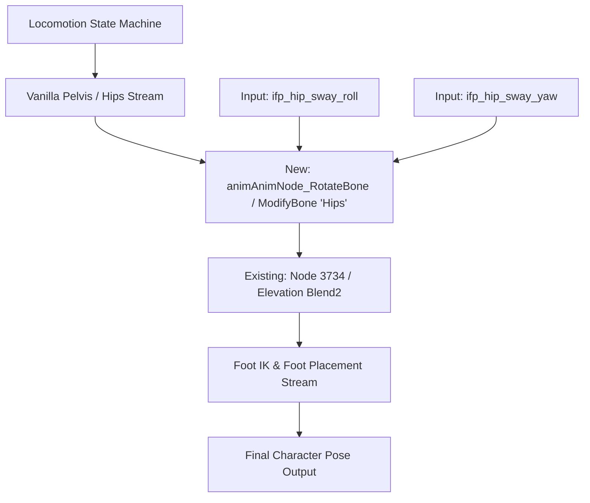

# Implementation Plan: Experimental Feminine Stride & Hip Sway (Approach 1)

**Feature Name:** Experimental Additive Procedural Hip Sway for High Heels  
**Target Mod:** Immersive Footwear POV (v2.1.0-exp)  
**Complexity:** Medium-Large  
**Status:** Planned / Experimental  

---

## 1. Executive Summary

This feature adds procedural hip movement (sway, roll, and tilt) during character locomotion that dynamically scales with the equipped footwear's heel height. Flat footwear retains the standard neutral walk cycle, while high heels and platform boots introduce an elegant, feminine stride with exaggerated pelvic weight-shifting.

For first-person view using the **Immersive First Person (IFP)** mod, natural head bobbing caused by the swaying spine is preserved by default to maximize immersion, but accompanied by an explicit, accessible user toggle to disable it for motion-sickness prevention or steady-cam preference.

---

## 2. Requirements & Acceptance Criteria

### 2.1 Core Locomotion Mechanics
1. **Dynamic Scaling with Heel Height:**
   - $0\text{ cm}$ (Flats, sneakers, barefoot): $0\%$ sway multiplier (standard vanilla walk).
   - $1\text{ cm} - 5\text{ cm}$ (Low heels, kitten heels): $20\% - 50\%$ subtle sway.
   - $6\text{ cm} - 12+\text{ cm}$ (High heels, stilettos, platform boots): $60\% - 100\%$ pronounced hip roll and tilt.
2. **Locomotion Context Awareness:**
   - Active only during walking and slow jogging ($\text{speed} > 0.1\text{ m/s}$).
   - Automatically and smoothly fades to $0$ during:
     - Sprinting, dodging, sliding, mantling/vaulting.
     - Crouching and sneaking.
     - Combat weapon aiming (ADS) and melee charge attacks.
     - In-vehicle and workspot interactions.

### 2.2 First-Person Camera & Head Bob Handling (IFP)
1. **Preserve Immersion:**
   - In IFP, the camera is bound to the player puppet's `Head`/`Eyes` bone. As the pelvis tilts and rotates, natural spine flex induces realistic rhythmic lateral and rotational camera motion (head bob).
2. **Optional User Toggle:**
   - Add a settings toggle: `Enable 1st-Person Head Bob (IFP)`.
   - **When ON:** Full natural head bobbing is active in IFP view.
   - **When OFF:** Hip sway is either isolated exclusively to 3rd-person view (ITP), or the cervical spine (`Neck`/`Head`) receives counter-rotation compensation to lock the camera horizon stable while maintaining visible lower-body sway.

### 2.3 User Interface & Configuration
- New settings section in CET ImGui menu: `[Experimental] Feminine Stride & Hip Sway`.
- Controls:
  - `[x] Enable Dynamic Hip Sway (Heels)`
  - `[ ] Enable 1st-Person Head Bob in IFP` (Requested Toggle)
  - Slider: `Sway Amplitude Multiplier (50% - 150%)`
- Settings persisted in `ImmersiveFootwearPOV_Settings.json`.

---

## 3. Architecture & Technical Breakdown

### 3.1 Kinematic Mathematical Model
A natural feminine walking gait comprises three rhythmic pelvic rotations:
1. **Pelvic Roll (Tilt in Frontal Plane / local $Y$-axis):**
   - The hip drops slightly on the swing leg and rises on the weight-bearing stance leg.
   - $\text{Roll}(t) = A_{\text{roll}} \times \sin(\omega t)$
   - Amplitude: $\approx \pm 2.5^\circ - 4.5^\circ$ at $10\text{cm}$ heel height.
2. **Pelvic Yaw (Rotation in Transverse Plane / local $Z$-axis):**
   - The pelvis rotates forward with the advancing swing leg to increase stride length.
   - $\text{Yaw}(t) = A_{\text{yaw}} \times \cos(\omega t)$
   - Amplitude: $\approx \pm 3.0^\circ - 5.0^\circ$.
3. **Lateral Translation (Side-to-Side Shift in local $X$-axis):**
   - Center of mass shifts laterally over the weight-bearing foot.
   - $\Delta X(t) = A_x \times \sin(\omega t)$
   - Amplitude: $\approx \pm 1.0\text{ cm} - 1.8\text{ cm}$.

$$\omega = 2\pi \times f_{\text{stride}}(\text{Speed})$$

---

### 3.2 Animgraph Integration Pipeline (`player_base.animgraph`)

Building on our existing injection architecture in `tools/inject_itp_elevation.py`:



#### New Variables in `player_base.animgraph`:
- `ifp_hip_sway_roll` (`animAnimVariableFloat`): Real-time roll angle in radians/degrees.
- `ifp_hip_sway_yaw` (`animAnimVariableFloat`): Real-time yaw angle in radians/degrees.
- `ifp_hip_sway_blend` (`animAnimVariableFloat`): Master blend weight ($0.0 \to 1.0$) controlling activation.

#### Bone Targets:
- Target Bone: `Hips` (Parent of `Spine1`, `LeftUpLeg`, `RightUpLeg`).
- Modifications apply *upstream* of Foot IK nodes so inverse kinematics automatically adapts foot grounding without clipping through terrain.

---

### 3.3 Camera Isolation Strategy (Head Bob Toggle)

| Mode | CET / Animgraph Logic | Player Experience |
|---|---|---|
| **3rd Person (ITP)** | Always applies full sway when enabled. | Fluid, elegant runway walk with hip sway. |
| **1st Person (IFP) + Head Bob ON** | Applies full sway to `Hips`; spine transfers motion to `Head`. | Immersive, realistic walking sensation matching shoe heels. |
| **1st Person (IFP) + Head Bob OFF** | Fades `ifp_hip_sway_blend` to `0.0` while in FPP camera state. | Completely smooth, stable camera with zero motion sickness. |

---

## 4. Implementation Tasks & Phases

### Phase 1: Kinematic Oscillator in CET Lua
- [ ] Create `source/resources/bin/x64/plugins/cyber_engine_tweaks/mods/ImmersiveFootwearPOV/modules/stride.lua`.
- [ ] Implement stride phase accumulator synchronized with `player:GetVelocity()`.
- [ ] Compute instantaneous roll, yaw, and lateral shift modulated by `currentShoeState.heelCm`.
- [ ] Implement smooth attack/decay damping ($0.15\text{s}$ blend-in on start, $0.20\text{s}$ fade-out on stop/sprint).

### Phase 2: Animgraph Node Injection
- [ ] Update `tools/inject_itp_elevation.py` to register new animgraph float variables:
  - `ifp_hip_sway_roll`
  - `ifp_hip_sway_yaw`
  - `ifp_hip_sway_blend`
- [ ] Insert `animAnimNode_RotateBone` targeting bone `Hips` downstream of locomotion and upstream of foot elevation node.
- [ ] Rebuild `player_base.animgraph` and compile `##_ITP_Immersive_Footwear_POV.archive`.

### Phase 3: Head Bob Control & FPP Decoupling
- [ ] In `stride.lua`, monitor active camera perspective (`CheckIsTPPActive`).
- [ ] If in FPP and `settings.enableFPPHeadBob == false`, clamp sway blend factor to `0.0`.
- [ ] If in FPP and `settings.enableFPPHeadBob == true`, pass full sway values.
- [ ] If in 3rd person (ITP), always pass full sway values regardless of FPP head bob toggle.

### Phase 4: CET UI & Configuration Persistence
- [ ] Update `modules/config.lua` to store:
  - `enableHipSway` (Bool, default: `true` for testing)
  - `enableFPPHeadBob` (Bool, default: `true`)
  - `hipSwayIntensity` (Float, default: `1.0`)
- [ ] Extend `integrations/ifp.lua` and `init.lua` ImGui window with experimental controls and diagnostic readout.

### Phase 5: Testing, Foot IK Validation & Tuning
- [ ] Verify foot grounding on flat pavement, stairs, and slopes in Night City.
- [ ] Tune sway angle ceilings to avoid unnatural exaggerations ($< 5.0^\circ$).
- [ ] Test transitions between walk $\to$ jog $\to$ sprint $\to$ combat slide.
- [ ] Validate 0 compile errors with `scc_lib` and clean packaging.

---

## 5. Risk Assessment & Mitigations

| Risk | Impact | Mitigation Strategy |
|---|---|---|
| **Foot Sliding / Skewed IK** | Feet might visually slide if hips move too far laterally. | Keep lateral hip displacement small ($\le 1.5\text{cm}$) and let foot IK lock bones to the floor. |
| **Motion Sickness in FPP** | Player sensitivity to rotational camera bob in 1st person. | Explicit user toggle `Enable 1st-Person Head Bob` with conservative default angles ($< 2.5^\circ$). |
| **Sprint / Combat Jitter** | Abrupt transition when drawing weapons or entering combat. | Modulate sway weight by `(1.0 - sprint) * (1.0 - crouch) * (1.0 - aiming)`. |
| **Load Order Conflicts** | Overriding animations may collide with other animation mods. | Maintain `##_` prefix priority archive and isolated additive bone nodes. |

---

## 6. Verification Plan

```powershell
# 1. Compile modified animgraph
python tools/inject_itp_elevation.py

# 2. Pack archive & deploy to game
powershell -ExecutionPolicy Bypass -File tools/pack_and_deploy.ps1

# 3. Validate REDscript compilation (0 errors)
python C:\Users\cogli\.gemini\config\skills\cp77-tweakdb-tools\scripts\compile_redscripts.py
```

- **In-Game Checks:**
  1. Equip high heels ($+8\text{cm}$) $\to$ observe graceful hip sway in 3rd person (ITP).
  2. Switch to 1st person (IFP) with Head Bob **ON** $\to$ observe realistic rhythmic camera motion.
  3. Toggle Head Bob **OFF** $\to$ observe instant steady-cam stabilization in FPP while hip sway remains in 3rd person.
  4. Equip flat sneakers ($0\text{cm}$) $\to$ verify sway completely ceases.
