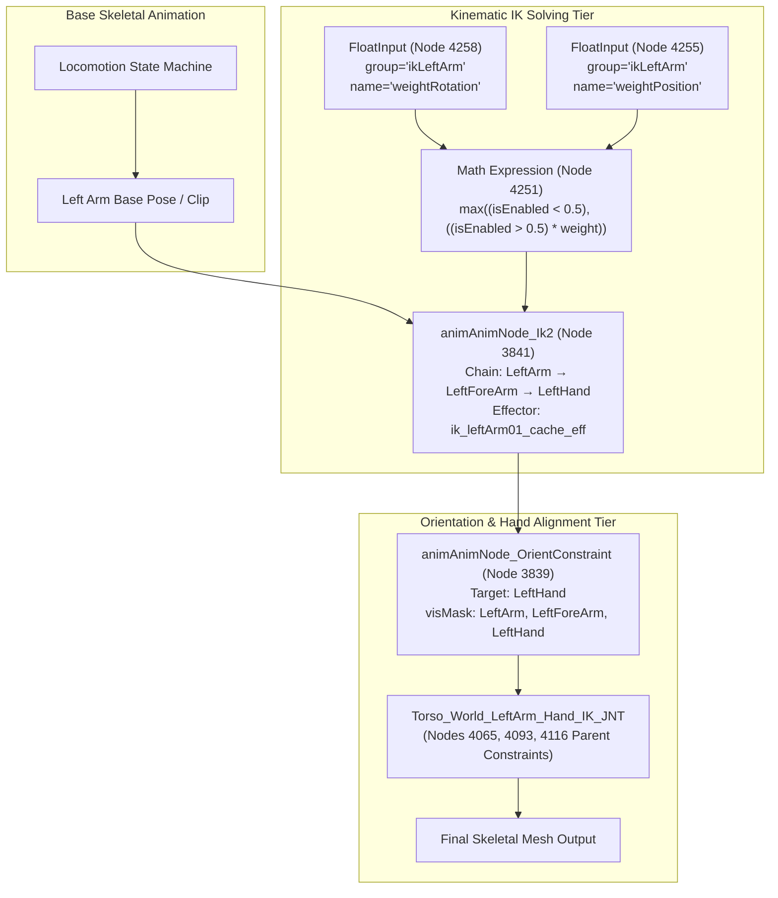

# Technical Research: AnimGraph Movement Variables & Limb Rotation Architecture

**Target Project:** Immersive Footwear POV & Feminine Catwalk Locomotion  
**Context:** Cyberpunk 2077 (Patch 2.0+ / Patch 2.31+) / REDengine 4 / `player_base.animgraph.json`  
**Date:** October 2026  
**Document Status:** Complete Empirical Engine Analysis via `animgraph_toolkit`  

---

## 1. Executive Summary

This research establishes a comprehensive technical catalog of all movement variables, skeletal limb targets, and rotational control nodes within the player character animation graph (`player_base.animgraph.json`).

The analysis was extracted and verified using the automated static analyzer and traversal engine of the dedicated [animgraph_toolkit](file:///c:/Users/cogli/Documents/CyberPunk%20-%20Projects/Immersive%20Footwear%20POV/tools/animgraph_toolkit).

### Key Architectural Findings:
1. **Total Declared Variables:** The graph root declares **86 variables** (73 `floatVariables`, 6 `vectorVariables`, 5 `boolVariables`, 2 `intVariables`).
2. **Three-Tier Arm & Hand Kinematics:** Limb movement is governed through a layered hierarchy:
   - **Tier 1 (Base Motion):** Locomotion clips and state machine blend spaces.
   - **Tier 2 (2-Bone IK Solvers):** `animAnimNode_Ik2` nodes for the left arm (`Node 3841`), right arm (`Node 3838`), and right wrist (`Node 3788`).
   - **Tier 3 (Orientation & Direct Constraints):** `animAnimNode_OrientConstraint` nodes for `LeftHand` (`Node 3839`), `RightHand` (`Node 3836`), `LeftFoot` (`Node 3845`), and `RightFoot` (`Node 3842`).
3. **Explicit Bone Rotation Nodes:** The graph contains exactly **10 `animAnimNode_RotateBone` nodes**, governing hip sway, spine counter-rotations, leg counter-roll, combat aim offsets, and consumable orientation.

---

## 2. Left Arm & Hand Kinematic Architecture

In REDengine 4, arm and hand movement is not purely forward-kinematic (FK). An analytical Inverse Kinematic (IK) solver dynamically overrides the shoulder-elbow-wrist chain for weapon holding, climbing, aiming, and object interaction.

### Detailed Left Arm Node Breakdown

| Node ID | Node Type | Target Bone / Joint | Input / Driver Source | Engine Function |
| :---: | :--- | :--- | :--- | :--- |
| **`3841`** | `animAnimNode_Ik2` | `ik_leftArm01_cache_eff` (end: `LeftHand`) | `weightNode` = Node `4251` | Two-bone IK solver calculating elbow bend and hand positioning. |
| **`3839`** | `animAnimNode_OrientConstraint` | `LeftHand` | `inputTransforms` = Node `4259` (`ik_leftArm01_cache_eff`) | Aligns hand orientation with IK target; masks `LeftArm`, `LeftForeArm`, `LeftHand`. |
| **`4251`** | `animAnimNode_MathExpressionFloat` | N/A | Evaluates `isEnabled` & `weight` | Dynamic weight blending for Left Arm IK. |
| **`4258`** | `animAnimNode_FloatInput` | `group="ikLeftArm"` | `name="weightRotation"` | Blends rotational influence between animation clip and IK solver. |
| **`4255`** | `animAnimNode_FloatInput` | `group="ikLeftArm"` | `name="weightPosition"` | Blends positional reach between animation clip and IK solver. |
| **`3863`** | `animAnimNode_MultipleParentConstraint` | `Torso_LeftArm_Hand_IK_JNT` | Torso space multi-parent | Anchors hand IK target to torso/chest coordinate space. |
| **`3862`** | `animAnimNode_MultipleParentConstraint` | `Torso_LeftArm_PoleVector_JNT` | Torso space multi-parent | Constrains left elbow pole vector orientation. |
| **`4065`** | `animAnimNode_ParentConstraint` | `Torso_World_LeftArm_Hand_IK_JNT` | World coordinate transform | Locks left hand in world space during climbing or cover. |
| **`4032`** | `animAnimNode_FloatTrackDirectConnConstraint` | `left_hand_offset` | Direct track curve | Applies dynamic bone positional offset along axis tracks. |
| **`4067`** | `animAnimNode_SetBonePosition` | `left_hand_offset` | Track input | Sets absolute translation on hand offset joint. |

---

## 3. Variables Controlling Arms & Hands

The following declared variables directly manipulate arm placement, weapon holding, and hand rotation:

| Variable Name | Type | Range / Format | Default | Engine Functionality |
| :--- | :---: | :---: | :---: | :--- |
| **`disable_maya_engine_left_hand`** | `Float` | `[0.0, 1.0]` | `0.0` | Toggles off procedural Maya engine solver for the left hand. |
| **`disable_maya_engine_right_hand`** | `Float` | `[0.0, 1.0]` | `0.0` | Toggles off procedural Maya engine solver for the right hand. |
| **`pla_left_hand_attach`** | `Float` | `[0.0, 1.0]` | `0.0` | Snaps/locks left hand to vehicle controls, steering wheels, ladders, or two-handed weapon grips. |
| **`pla_right_hand_attach`** | `Float` | `[0.0, 1.0]` | `0.0` | Snaps/locks right hand to weapon handles and interactive objects. |
| **`weapon_rotation_shoulder`** | `Vector4` | Quaternion | `[0, 0, 0, 1]` | Sets 3D rotational orientation offset of arm/weapon relative to shoulder socket. |
| **`weapon_rotation_aiming`** | `Vector4` | Quaternion | `[0, 0, 0, 1]` | Sets 3D rotational orientation offset of arm/weapon in ADS aim posture. |
| **`weapon_offset_shoulder`** | `Vector4` | `[-0.2, 0.2]` m | `[0, 0, 0, 1]` | Positional 3D translation offset of arm/weapon origin relative to shoulder. |
| **`weapon_offset_aiming`** | `Vector4` | `[-0.2, 0.2]` m | `[0, 0, 0, 1]` | Positional 3D translation offset of arm/weapon in ADS aim state. |
| **`aiming`** | `Float` | `[0.0, 1.0]` | `0.0` | Blends arm postures from relaxed/hip into raised weapon sighting. |
| **`aiming_blend_time`** | `Float` | `[0.0, 100.0]` s | `0.10` | Transition smoothing duration into weapon aim state. |
| **`aimsway`** | `Float` | `[0.0, 1.0]` | `0.0` | Applies procedural breathing/stamina sway directly into hand and wrist aim constraints. |
| **`quickmelee`** | `Int` | `[0, 16]` | `0` | Controls melee attack animation selection and arm strike sequences. |

---

## 4. Complete Catalog of Bone Rotation Nodes

The graph contains **10 `animAnimNode_RotateBone` nodes** applying targeted rotational transforms along specific axes:

| Node ID | Target Bone | Axis | Driver Input Node | Controlling Variable / Source | Clinical / Gameplay Purpose |
| :---: | :--- | :---: | :---: | :--- | :--- |
| **`6060`** | `RightUpLeg` | `Y_Axis` | `Node 6061` (FloatVar) | `ifp_leg_counter_roll` | Procedural counter-roll on right thigh during hip sway. |
| **`6058`** | `LeftUpLeg` | `Y_Axis` | `Node 6059` (FloatVar) | `ifp_leg_counter_roll` | Procedural counter-roll on left thigh during hip sway. |
| **`6056`** | `Spine2` | `Y_Axis` | `Node 6057` (FloatVar) | `ifp_spine_counter_roll` | Thoracic counter-roll compensating for lateral hip tilt. |
| **`6054`** | `Spine2` | `Z_Axis` | `Node 6055` (FloatVar) | `ifp_spine_counter_yaw` | Thoracic counter-yaw keeping chest facing forward during stride sway. |
| **`6052`** | `Hips` | `Z_Axis` | `Node 6053` (FloatVar) | `ifp_hip_sway_yaw` | Pelvic yaw rotation on stride cadence (Catwalk Stride). |
| **`6050`** | `Hips` | `Y_Axis` | `Node 6051` (FloatVar) | `ifp_hip_sway_roll` | Pelvic lateral roll rotation on weight-bearing stance. |
| **`1827`** | `handaim_offset` | `X_Axis` | Default / Pose link | Static combat pose | Hand pitch rotation during combat/vehicle weapon aim. |
| **`1818`** | `DriverCombatAim_offset` | `X_Axis` | `Node 1819` (FloatJoin) | Combat aim system | Weapon / arm aim pitch while in vehicle combat. |
| **`1826`** | `headaim_offset` | `X_Axis` | `Node 1819` (FloatJoin) | Head tracking system | Head aim pitch offset matching weapon aim direction. |
| **`3093`** | `Hips` | `Z_Axis` | `Node 3094` (FloatVar) | `tpp_consumable_yaw` | Third-person hips yaw rotation during consumable animations. |

### Limb Orientation Constraints (`animAnimNode_OrientConstraint`)

In addition to single-axis rotation nodes, full 3D quaternion orientation constraints lock limb and extremity rotations:

* **`Node 3839`**: `LeftHand` (driven by Left Arm IK solver `ik_leftArm01_cache_eff`)
* **`Node 3836`**: `RightHand` (driven by Right Arm IK solver `ik_rightArm01_cache_eff`)
* **`Node 3787`**: `RightHand` (driven by wrist aim effector `r_wrist01_eff`)
* **`Node 3845`**: `LeftFoot` (ground alignment orientation constraint)
* **`Node 3842`**: `RightFoot` (ground alignment orientation constraint)

---

## 5. Locomotion, Stance, and Posture Variables

These variables drive character translation, stride cadence, and procedural posture:

### 5.1 Locomotion, Velocity & Direction
* **`speed_horizontal`** (`Float`, `[0, 16]` m/s, default `0.0`): Horizontal ground velocity driving stride length and arm pump cadence.
* **`speed_vertical`** (`Float`, `[-30, 30]` m/s, default `0.0`): Vertical velocity driving airborne, jump apex, and falling states.
* **`move_direction`** (`Float`, `[-180, 180]` deg, default `0.0`): Travel angle relative to camera heading (forward, strafe, backward).
* **`sprint`** (`Float`, `[0, 1]`, default `0.0`): Pushes arms into two-handed forward sprint pump.
* **`rotation_speed_yaw`** (`Float`, `[-360, 360]` deg/s, default `0.0`): Turning rate driving body angular centrifugal lean.
* **`rotation_speed_pitch`** (`Float`, `[-360, 360]` deg/s, default `0.0`): Pitch angular velocity driving head/torso incline.
* **`acceleration_horizontal`** (`Float`, `[-32, 32]` m/s², default `0.0`): Acceleration magnitude for stride starts and stops.

### 5.2 Body Stance & Action States
* **`crouch`** (`Float`, `[0, 1]`, default `0.0`): Lowers pelvic baseline and brings arms closer to body.
* **`slide`** (`Float`, `[0, 1]`, default `0.0`): Extends legs and engages one-handed ground brace pose.
* **`jump`** & **`doublejump`** (`Float`, `[0, 1]`, default `0.0`): Initiates aerial takeoff.
* **`fall`** & **`softland`** (`Float`, `[0, 1]`, default `0.0`): Manages airborne limb flail and knee flexion on impact.
* **`vault`**, **`climb`**, **`ladder`** (`Float`, default `0.0`): Engages two-handed kinematic climbing and ledge mantling.

### 5.3 Footwear Elevation & Procedural Sway Variables
* **`foot_elevation_offset`** (`Float`, `[-1.0, 1.0]` m, default `0.0`): Controls vertical puppet elevation on `Node 6042` (`ITP_Hips_Elevation_Pos100cm`).
* **`ifp_height_blend`** (`Float`, `[0.0, 1.0]`, default `0.5`): Blend weight for the 30-node IFP height compensation tree between `Node 3903` and `3904`.
* **`ifp_height_contract_v2_signed_50cm`** (`Float`, `[0.0, 1.0]`, default `0.5`): Bipolar signed height offset for first-person camera positioning.
* **`ifp_hip_sway_roll`** & **`ifp_hip_sway_yaw`** (`Float`, `[-45.0, 45.0]` deg, default `0.0`): Drive pelvic lateral roll and yaw rotation on nodes `6050` and `6052`.
* **`ifp_spine_counter_roll`** & **`ifp_spine_counter_yaw`** (`Float`, `[-45.0, 45.0]` deg, default `0.0`): Drive thoracic counter-rotation on nodes `6056` and `6054`.
* **`ifp_leg_counter_roll`** (`Float`, `[-45.0, 45.0]` deg, default `0.0`): Drives thigh counter-roll on nodes `6058` and `6060`.

---

## 6. Procedural Implementation Guide: Left Hand on Hip

To implement a procedural **Left Hand on Hip** posture during locomotion:

1. **Option A: Rotation Override via `animAnimNode_RotateBone`**:
   - Inject 3 sequential rotation nodes upstream of the terminal output:
     - `LeftArm` Pitch: Neutralizes locomotion arm swing ($\approx \mp 28^\circ$).
     - `LeftArm` Roll/Yaw: Brings elbow lateral and rotates upper arm toward hip.
     - `LeftForeArm` Bend: Flexes elbow to approximately $85^\circ$ to place the hand against the iliac crest.
   - Controlled by a dedicated variable `itp_hand_on_hip_blend` (`[0.0, 1.0]`).
2. **Option B: IK Effector Override via `animAnimNode_Ik2`**:
   - Tap into `Node 3841` (`ik_leftArm01_cache_eff`).
   - Re-target the left hand effector to a custom socket parented directly to `Hips` or `Torso_Hips_RotatePoint_GRP`.
   - Modulate weight via `Node 4251`.

Both options can be implemented cleanly using the [PipelineBuilder](file:///c:/Users/cogli/Documents/CyberPunk%20-%20Projects/Immersive%20Footwear%20POV/tools/animgraph_toolkit/builder/pipeline_builder.py) and verified with [GraphValidator](file:///c:/Users/cogli/Documents/CyberPunk%20-%20Projects/Immersive%20Footwear%20POV/tools/animgraph_toolkit/core/validator.py) to ensure zero dangling references or handle collisions.
