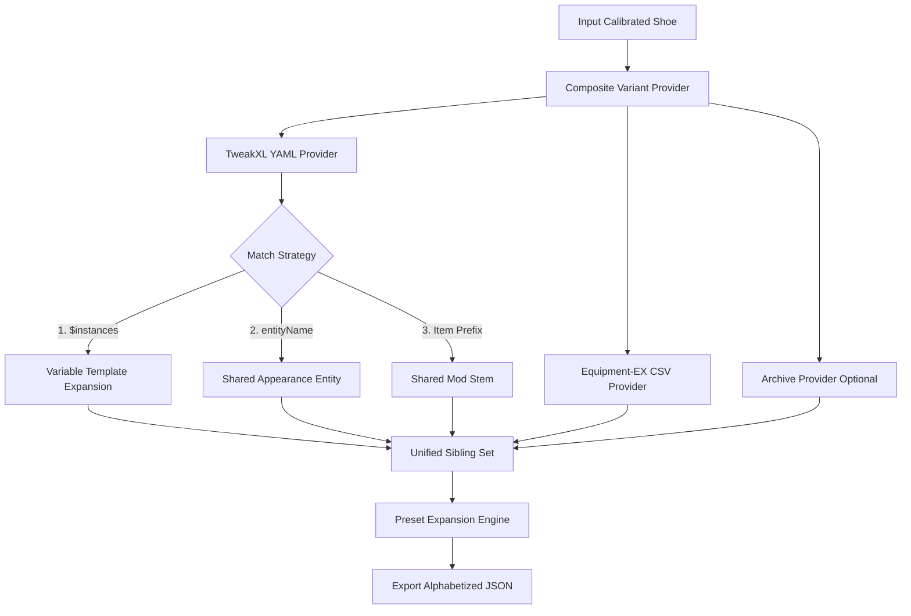

# Immersive Footwear POV — Preset Variant Expander Tool Guide

An automated CLI tool that discovers shoe variant clusters (colors, materials, patterns, and instances) across mod files and expands single-item footwear calibrations into complete preset collections for **Immersive Footwear POV**.

---

## 1. Overview & Purpose

When playing with modded footwear in Cyberpunk 2077, custom shoe packs often contain dozens of color, fabric, and texture variants (e.g., black, red, white, latex, velvet, cheetah) that share the exact same physical mesh, sole thickness, and heel height.

Manually calibrating each colorway in Photo Mode or CET is tedious. The **Preset Variant Expander** automates this by:
1. Reading your existing shoe height calibrations from `user_shoe_overrides.json` or `presets.json`.
2. Scanning game directories for mod definitions:
   * **TweakXL YAMLs** (`r6/tweaks/`)
   * **Equipment-EX CSV tables** (`r6/tweaks/` / mod tables)
   * *(Optional)* **WolvenKit Archive inspection** (`archive/pc/mod/`)
3. Resolving sibling records via `$instances` variable substitution, shared entity templates, and common item stems.
4. Auto-generating a clean, alphabetized preset pack containing height calibrations for all discovered variants.

---

## 2. Key Features

* **Zero-Touch Variant Discovery:** Automatically links all colorways and material instances that belong to the same shoe model.
* **Dual TweakXL Syntax Support:** Fully parses both `$(var)` and `${var}` template expansion formats.
* **Safe Template Isolation:** Prevents cross-contamination by scoping instances to their respective item templates (e.g., shoe variants won't pull in horns, chokers, or gloves from the same mod pack).
* **Isolated Persistence & Clean Output:** Automatically filters out non-shoe configuration keys (such as `__settings`), strips trailing whitespace, and sorts all entries alphabetically for clean Git diffs and quick reading.
* **Conflict Protection:** Preserves existing custom calibrations by default; existing entries are never overwritten unless `--overwrite` is explicitly specified.
* **Dry-Run & Verbose Diagnostics:** Test and preview exact match mechanisms (`[TweakXL:instances]`, `[TweakXL:shared_entity]`, etc.) and source files before modifying files on disk.

---

## 3. Installation & Requirements

* **Python 3.9+**
* **Dependencies:** `PyYAML`
  ```bash
  pip install pyyaml
  ```
* **Cyberpunk 2077:** Patch 2.1+ with **Cyber Engine Tweaks (CET)** and **TweakXL**.

---

## 4. Command-Line Reference

Run the tool as a Python module from your project root:

```bash
python -m tools.preset_variant_expander [OPTIONS]
```

### CLI Arguments

| Argument | Short | Description |
| :--- | :--- | :--- |
| `--input <path>` | `-i` | **(Required)** Path to the source JSON file (e.g., `user_shoe_overrides.json` or `presets.json`). |
| `--output <path>` | `-o` | Target path for the expanded JSON file. Defaults to updating the input file in-place. |
| `--game-dir <path>` | `-g` | Cyberpunk 2077 root directory. Defaults to `D:\SteamLibrary\steamapps\common\Cyberpunk 2077` if present. |
| `--tweaks-dir <path>` | `-t` | Custom tweaks directory to scan (defaults to `<game-dir>/r6/tweaks`). |
| `--archive-dir <path>` | `-a` | Custom archive directory to scan (defaults to `<game-dir>/archive/pc/mod`). |
| `--scan-archives` | | Enables deep WolvenKit CLI scanning of `.archive` packages (off by default; TweakXL YAMLs contain 99% of modded item definitions). |
| `--dry-run` | | Analyzes and previews discovered variants without writing any changes to disk. |
| `-v`, `--verbose` | `-v` | Displays detailed per-item match rules (`[TweakXL:instances]`, `[TweakXL:shared_entity]`) and source YAML filenames. |
| `--overwrite` | | Overwrites existing calibrations if new sibling data with different values is encountered. |

---

## 5. Common Workflows & Examples

### 1. Preview Variant Expansions (Safe Dry Run)
Test your current user overrides against the game folder to see what variants can be found without modifying any files:
```powershell
python -m tools.preset_variant_expander `
  -i "D:\SteamLibrary\steamapps\common\Cyberpunk 2077\bin\x64\plugins\cyber_engine_tweaks\mods\ImmersiveFootwearPOV\user_shoe_overrides.json" `
  -t "D:\SteamLibrary\steamapps\common\Cyberpunk 2077\r6\tweaks" `
  -v --dry-run
```

### 2. Export to a Community Preset Pack (`presets.json`)
Read your custom calibrations from `user_shoe_overrides.json` and export the full variant catalog to `presets.json` so all variants work automatically out-of-the-box:
```powershell
python -m tools.preset_variant_expander `
  -i "D:\SteamLibrary\steamapps\common\Cyberpunk 2077\bin\x64\plugins\cyber_engine_tweaks\mods\ImmersiveFootwearPOV\user_shoe_overrides.json" `
  -o "D:\SteamLibrary\steamapps\common\Cyberpunk 2077\bin\x64\plugins\cyber_engine_tweaks\mods\ImmersiveFootwearPOV\presets.json" `
  -t "D:\SteamLibrary\steamapps\common\Cyberpunk 2077\r6\tweaks"
```

### 3. Expand an Existing Preset Pack In-Place
Take an existing community preset file and expand it with any newly installed mods:
```powershell
python -m tools.preset_variant_expander `
  -i "source/resources/bin/x64/plugins/cyber_engine_tweaks/mods/ImmersiveFootwearPOV/shoe_presets.example.json" `
  -g "D:\SteamLibrary\steamapps\common\Cyberpunk 2077"
```

### 4. Custom GOG / Epic / Non-Default Installation Path
Specify a custom game directory or custom folder paths:
```powershell
python -m tools.preset_variant_expander `
  -i "C:\Games\Cyberpunk 2077\bin\x64\plugins\cyber_engine_tweaks\mods\ImmersiveFootwearPOV\user_shoe_overrides.json" `
  -g "C:\Games\Cyberpunk 2077" `
  -v
```

---

## 6. How Expansion Matches Sibling Footwear

The tool uses a composite strategy engine:



1. **`TweakXL:instances`**: Detects `$instances` definitions where an item key like `Items.phoebe_peep_toe_sandals_${base_color}` expands into multiple colorways (`black`, `white`, `aqua`, etc.).
2. **`TweakXL:shared_entity`**: Detects distinct records sharing an underlying `.ent` entity resource (e.g. `meluminary_shoe_megapak`).
3. **`TweakXL:sibling_prefix`**: Clusters sibling records sharing common prefix stems within the same YAML file.
4. **`EquipmentEX:csv`**: Reads clothing entries registered across outfit CSV tables.

---

## 7. JSON Format Specification

The generated presets follow the standard Immersive Footwear POV schema:

```json
{
  "Items.imperator_heels_black": {
    "heel": 12.0,
    "platform": 4.0
  },
  "Items.imperator_heels_blue": {
    "heel": 12.0,
    "platform": 4.0
  },
  "Items.phoebe_peep_toe_sandals_aqua": {
    "heel": 11.0,
    "platform": 2.0
  },
  "Items.phoebe_peep_toe_sandals_white": {
    "heel": 11.0,
    "platform": 2.0
  }
}
```

* **`heel`**: Full heel height in centimeters (`float`, rounded to 2 decimal places). Drives FPP camera elevation and CET catwalk sway pitch.
* **`platform`**: Platform sole thickness in centimeters (`float`, rounded to 2 decimal places). Drives Photo Mode puppet elevation.

---

## 8. Running Automated Tests

A dedicated suite of unit tests validates the expander engine, repository serialization, and TweakXL YAML parsing:

```bash
python -m unittest discover -s tools/preset_variant_expander/tests -t .
```

---

## 9. Standalone Executable & Distribution

For preset creators and community modders who do not have Python installed, the tool can be distributed as a zero-dependency standalone `.exe`:

* **Ready-to-share Zip:** `dist/PresetVariantExpander-Standalone.zip` (contains the `.exe` and a quick-start `README.txt`).
* **Standalone Directory:** `dist/PresetVariantExpander-Standalone/`
  * `PresetVariantExpander.exe`: Single-file portable Windows executable (supports interactive wizard and direct drag-and-drop).
  * `README.txt`: Plain-text quick start guide.

### Building the Standalone Executable

To rebuild the standalone executable from source:
```bash
python -m PyInstaller --onefile --name "PresetVariantExpander" --clean --collect-all yaml tools/preset_variant_expander/standalone_main.py
```

